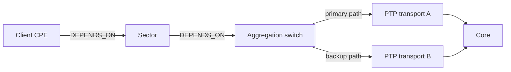
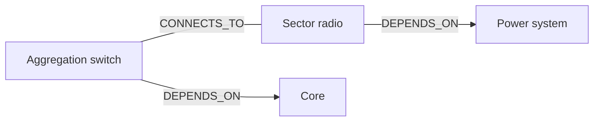

# CI Failure Correlation Topology Guide

This guide defines how to model CI relationships so that failure correlation identifies a plausible root cause without suppressing independent incidents.

> **Current implementation note:** the correlation query traverses `DEPENDS_ON`, `HOSTED_ON`, and `CONNECTS_TO` from a dependent CI toward an upstream CI, with a maximum depth of three hops. This document defines the target modeling policy; it does not change runtime behavior.

## Quick path

1. Model an operational dependency from the dependent CI to the CI it needs to function.
2. Use `DEPENDS_ON` for relationships that may propagate a root cause.
3. Keep physical or informational connectivity separate from causal dependency.
4. Verify a six-level representative chain before changing the correlation depth.
5. Treat redundant paths as a design decision, not an automatic propagation path.

## Core rule

A failure on CI `A` may explain a failure on CI `B` only when `B` cannot provide its monitored service without `A`.

The arrow always points from the **dependent** CI to its **dependency**:

```text
B -[:DEPENDS_ON]-> A
```

When `A` has an active root event and `B` fails for a propagating metric, `B` is an affected CI. It is not a separate root cause.

## Relationship policy

| Relationship | Meaning | Eligible for root-cause traversal? | Modeling rule |
| --- | --- | --- | --- |
| `DEPENDS_ON` | A CI needs another CI or service to operate. | Yes | Use for explicit operational and causal dependencies. Direction is dependent → dependency. |
| `HOSTED_ON` | A workload, virtual device, or service is hosted by a platform. | Usually yes | Use only when failure of the host makes the hosted CI unavailable. Direction is hosted CI → host CI. |
| `CONNECTS_TO` | Two CIs have a physical, logical, or transport connection. | Not by default | Do not assume it is causal. Use it for topology/visualization unless its direction and failure semantics are explicitly defined. |

`CONNECTS_TO` is the most important ambiguity to resolve. A radio link, client CPE, switch port, or PTP endpoint can be connected while having different failure domains. Connectivity alone does not prove that one CI is the root cause of the other.

## Six-level sector-network example

The example below models a customer device reaching the destination network through a sector, concentrator, and PTP transport. Each `DEPENDS_ON` arrow points toward the upstream dependency.

```mermaid
flowchart LR
  CPE[Level 1: Customer CPE]
  Access[Level 2: Access radio link]
  Sector[Level 3: Sector antenna]
  Switch[Level 4: Concentrator switch]
  PtpNear[Level 5: PTP near endpoint]
  PtpFar[Level 6: PTP far endpoint]
  Core[Destination network / core]

  CPE -->|DEPENDS_ON| Access
  Access -->|DEPENDS_ON| Sector
  Sector -->|DEPENDS_ON| Switch
  Switch -->|DEPENDS_ON| PtpNear
  PtpNear -->|DEPENDS_ON| PtpFar
  PtpFar -->|DEPENDS_ON| Core

  Sector -. physical RF path .-> Access
  PtpNear -. physical transport .-> PtpFar
```



### Expected result when the PTP fails

If `PtpFar` has an active root event, an affected CPE may be six hops away. A correlation depth of three cannot reach that event from the CPE in this model.

With a policy-approved depth of six or more, failures from the access chain can be associated with the PTP root event **only if every causal edge is modeled as `DEPENDS_ON` in the shown direction**.

The number of customer devices does not change the depth. Ten links with ten devices each increase the affected-CI fan-out, not the number of hops.

## Variable ecosystem: one topology, different outcomes

The same physical layout must not always produce the same correlation decision.

### A. Single-path access network


A PTP failure can be the root cause for the client because there is one operational path.

### B. Redundant upstream transport



Do **not** automatically mark all clients as affected when `PTP1` fails. First establish whether traffic actually failed over to `PTP2` and whether the monitored service is unavailable. This requires an explicit redundancy/failover policy.

### C. Physical connection without causal dependency



The physical `CONNECTS_TO` relationship is useful for visualization. It must not automatically imply that a radio event is caused by the switch, or vice versa.

## Event behavior

| Situation | Expected event behavior |
| --- | --- |
| No eligible active upstream event | Create or refresh a `ROOT` event for the failing CI. |
| Eligible active upstream root event | Record the CI as affected by that root cause and avoid a duplicate child incident when policy allows propagation. |
| Upstream root recovers | It must no longer be selected as an active root for future correlation. Recovery behavior for already affected CIs must be tested per event family. |
| Topology lookup fails | Preserve monitoring availability: fall back to independent `ROOT` events and alert operators about the correlation failure. |
| Metric is non-propagating | Keep the metric independent even if topology has an upstream event. |

Severity and correlation are separate concerns. A `WARNING` or `CRITICAL` event may be a root cause or a propagated symptom; severity does not establish causality by itself.

## Depth and performance policy

A greater depth expands the search scope; it does not fix an incorrect topology model.

| Option | Benefit | Risk |
| --- | --- | --- |
| Depth 3 | Bounded and inexpensive. | Misses legitimate long dependency chains. |
| Configurable depth 6–8 | Covers representative access/transport chains. | More graph traversal and potential false correlation if relationships are ambiguous. |
| Unbounded traversal | Covers arbitrary distance. | Unsafe: path expansion can grow rapidly in mesh-like topologies and may select distant, unrelated events. |

Before increasing the depth, capture execution plans and timings for a normal cycle and a fan-out incident. A simple dependency tree has low branching and is usually manageable; a graph containing many `CONNECTS_TO` edges can multiply candidate paths sharply.

## Modeling checklist

- [ ] Every propagation-eligible edge has direction: dependent → dependency.
- [ ] Every `DEPENDS_ON` edge represents a real operational failure dependency.
- [ ] `HOSTED_ON` is used only where host failure makes the child unavailable.
- [ ] `CONNECTS_TO` is not considered causal unless its semantics are explicitly approved.
- [ ] Redundant paths and failover behavior are documented.
- [ ] The intended maximum dependency depth is measured in production-like topology.
- [ ] A six-level chain and a fan-out scenario are covered by automated tests.
- [ ] A correlation lookup failure degrades safely to independent root events.

## Locked propagation decisions (issue #539)

These four decisions are approved by the maintainer and recorded here as the single source of truth for the chained implementation PRs (#539-PR2a1 through #539-PR2c2, #539-PR3, #539-PR4). The runtime contract lives in `backend/services/correlation_propagation_contract.py`; the parametrized tests in `backend/tests/test_correlation_propagation_contract.py` assert the constants match these values.

1. **`PhysicalLink.status = UNKNOWN` propagation — `degrade_severity_and_propagate`.** A PhysicalLink in `UNKNOWN` state (the default at creation, before the first poll) DOES propagate events, but propagation creates a **separate `PROPAGATED` Event** emitted at `WARNING` severity instead of the parent's severity. The **ROOT Event keeps its original severity** — the degradation applies only to the propagated child. The propagated Event keeps `root_cause_ci_id` pointing at the ROOT CI (never at the link), stays linked to the affected CI, and the modern SNMP path and the legacy path apply the same semantics so neither engine can erase the `WARNING` severity or double-propagate the same failure. Rationale: visibility for the operator outweighs the cost of a slightly higher signal floor. An `UNKNOWN` link is not the same as a confirmed-up link, so the event severity downgrade prevents operator alarm fatigue.

2. **Status freshness model — `re_query_per_correlation`.** The correlation traversal re-reads each `:CONNECTED_VIA` PhysicalLink's `status` at query time (within the same Cypher statement). No cache, no TTL. Rationale: slice 4 (#443) introduces polling that keeps status fresh; re-query is cheap given a properly indexed `:PhysicalLink` lookup, and the alternative (cached status) risks serving stale data during a flap.

3. **Behavior when PhysicalLink flips UP → DOWN — `generate_descendant_event`.** When polling observes a PhysicalLink transition from `UP` to `DOWN`, the system generates exactly one `physical_link_down` Event with `severity = CRITICAL` and `status = OPEN`. Its `root_cause_ci_id` is the **PhysicalLink id** (`PhysicalLink.id`, not a CI id), and its `affected_ci_ids` contain **both endpoints**. The Event is hosted by **endpoint A** (`ci_id = endpoint_a`; the `HAS_EVENT` relationship targets endpoint A only) so the operator feed shows a single row while endpoint B still appears as affected. The Event is **pruner-limited**: a later `UP` does not automatically recover, close, or pre-emptively close it. The existing event-pruner closes `RECOVERED` events only, so it does not close an OPEN `physical_link_down` Event as it stands today; **PR2c2 extends the existing pruner** so it closes an OPEN, unacknowledged `physical_link_down` Event once the Event's age exceeds `EVENT_PRUNE_STALE_AFTER_SECONDS` (existing default 3600 seconds), recording `status = CLOSED`, `closed_at`, and `closed_by = system-prune` (or the configured pruner actor). Rationale: a cable cut has a clear cause, and surfacing it as an event is more discoverable than blocking correlation in silence. Flap risk is bounded by the pruner's stale-event policy.

4. **`MANAGES` / `USES` / `PROVIDES` default — `all_propagate`.** When the rollout slice that carries them is enabled, the three relationship types are added to the traversal with default propagation. No per-CI flag, no per-metric flag, and no per-relationship env-var gate — the slice's own default-off rollout flag is the only switch. Rationale: the model is small (3 types) and the operational risk of over-propagation is bounded; if a real-world deployment surfaces a problem, a follow-up PR can introduce an opt-out flag.

## Reconciled connectivity contract (issue #539)

The four locked decisions above cover propagation policy. The reconciled contract for #539 also fixes the **connectivity** the propagation walks, because the current runtime has no `:PhysicalLink` edge writer, no backfill, and no repair path. This section records that contract.

### Canonical CI→PhysicalLink relationships

A PhysicalLink is a first-class graph node, and connectivity is expressed only as **two inbound edges**, one from each endpoint CI. Both edges point from an endpoint CI **to** the link:

```text
(endpoint_a:CI)-[:CONNECTED_VIA]->(pl:PhysicalLink)
(endpoint_b:CI)-[:CONNECTED_VIA]->(pl)
```

There is no `PhysicalLink → CI` edge: the link is the target of both endpoint edges, never the source. A link that exists only as a node with an `endpoints` list is not connected.

- **Creation.** `PhysicalLinkRepo.create()` MUST create the `:PhysicalLink` node **and** both inbound `CONNECTED_VIA` edges from its two endpoint CIs in the same write.
- **Backfill.** `backend/migrations/011_*.cypher` MUST rebuild the two inbound `CONNECTED_VIA` edges for every existing `:PhysicalLink` from its stored `endpoints`, and MUST be **idempotent** — re-running it creates no duplicate edges and no duplicate nodes.
- **Deletion repair.** Deleting an endpoint CI MUST remove the affected `:PhysicalLink` and its `CONNECTED_VIA` edges atomically. No orphan link may survive with a dangling endpoint reference, and no half-connected link may remain.
- **Public usage semantics.** `GET /api/nodes/{id}/usage` MUST preserve its **pre-#539 count**. Every relationship incident to the CI keeps its prior contribution — all pre-existing relationship types and all pre-existing targets, including non-CI targets such as `HAS_METRIC`, `OWNED_BY`, `CATEGORIZED_AS`, and `HAS_EVENT`. Only the newly introduced `CONNECTED_VIA` edges whose other endpoint is a `:PhysicalLink` are excluded, so the usage number does not move when PhysicalLink connectivity is added. The count is **not** narrowed to CI↔CI relationships.

### Correlation traversal shape

Correlation traversals MUST require an intermediate `:PhysicalLink` node. The traversal reads the two inbound edges as one hop — endpoint → link ← endpoint:

```text
(ci)-[:CONNECTED_VIA]->(pl:PhysicalLink)<-[:CONNECTED_VIA]-(peer:CI)
```

A traversal that matches `(:CI)-[:CONNECTED_VIA]->(:CI)` without the `:PhysicalLink` intermediate is forbidden. Dormant CI→CI `CONNECTED_VIA` seed edges exist in the bootstrap data (`docker/neo4j/init.cypher`) and MUST NOT be read as PhysicalLink hops — such an edge carries no `status`, so it can never be status-gated, and misreading it would either propagate without a status check or silently skip a real link.

### Pruner-limited recovery (PR2c2)

- The existing event-pruner closes `RECOVERED` events that are not acknowledged. It does **not** close `OPEN` events, so as it stands today it does not close an OPEN `physical_link_down` Event.
- **PR2c2 extends the existing event-pruner** so that it also closes an **OPEN, unacknowledged** `physical_link_down` Event once the Event's age exceeds `EVENT_PRUNE_STALE_AFTER_SECONDS` (existing default **3600** seconds).
- The pruner records `status = CLOSED`, `closed_at`, and `closed_by = system-prune` (or the configured pruner actor) — the same audit fields the existing prune path writes.
- A later PhysicalLink `UP` MUST NOT auto-recover or pre-emptively close the Event. Link recovery and Event lifecycle stay independent: the pruner's stale-event policy (or an explicit operator action) is the only path that closes the Event.

## Decision record (issue #539)

This record captures the implementation-blocking decisions for the chained PRs that resolve #539. Each item points to the implementation work it unblocks.

1. **PhysicalLink connectivity ownership.** The canonical shape is **two inbound edges** — `(endpoint_a:CI)-[:CONNECTED_VIA]->(pl:PhysicalLink)` and `(endpoint_b:CI)-[:CONNECTED_VIA]->(pl)`, with no `PhysicalLink → CI` edge — together with the idempotent `011` backfill, the deletion repair, and the preserved pre-#539 `/api/nodes/{id}/usage` count (every relationship incident to the CI keeps its prior contribution; only the newly introduced CI→PhysicalLink `CONNECTED_VIA` edges are excluded). All of that is part of the #539 contract (PR2a1). Correlation traversal additionally requires the `:PhysicalLink` intermediate (PR2a2) so dormant CI→CI seed edges are never misread as links. PR2c2 extends the event-pruner so it closes an OPEN, unacknowledged `physical_link_down` Event once its age exceeds `EVENT_PRUNE_STALE_AFTER_SECONDS` (existing default 3600 seconds).
2. **Relationship types eligible for backend root-cause traversal.** After all chained PRs land: `DEPENDS_ON` (always), `HOSTED_ON` (always), `:CONNECTS_TO` (always, with a `medium` predicate that excludes `vpn | sd_wan | satellite` — PR4), `:CONNECTED_VIA` (PhysicalLink — conditional on `status ∈ {UP, UNKNOWN}`, with `UNKNOWN` degrading severity per locked decision #1; PR2a2), `:MANAGES` / `:USES` / `:PROVIDES` (always; PR3). The pre-#539 implementation walks only 3 of these 6 — the chained PRs close the gap.
3. **`:CONNECTS_TO` ambiguity resolution.** Filtered, not removed. The `medium` predicate is added in PR4; until PR4 lands, behavior matches the existing 3-of-6 traversal (no behavior change in this PR1).
4. **Default and maximum traversal depth.** Default 3, maximum 3 (unchanged). The `Six-level sector-network example` earlier in this doc remains aspirational; raising depth requires its own evidence and review (out of scope for #539).
5. **Redundancy and active/standby paths.** Refer to the "Variable ecosystem" section above. No model change in this PR1.
6. **Performance budget.** Target: ≤50 ms added latency for the `re_query_per_correlation` decision in a topology with 100 CIs and 50 PhysicalLinks. Measured in PR2a2 with a benchmark; if exceeded, the decision reverts to `cache_with_ttl` and a follow-up decision is filed.
7. **Rollout, observability, rollback.** Per-slice feature flag, default off. The PhysicalLink chain ships behind `FEATURE_CMDB_CORRELATION_PHYSICAL_LINK_PROPAGATION_ENABLED=false`; flip to `true` only after the whole reconciled chain (PR2a1 → PR2c2) lands and CI is green. The standard `gentle-ai-chained-pr` review pattern applies.
8. **Unchanged constraints across the chain.** `backend/services/relationship_types.py:7-13` (`SUPPORTED_CI_RELATIONSHIP_TYPES`) stays at its 6 CI relationship types — only the traversal changes. Default and maximum traversal depth stays 3. No new `UserPermission` enum values are introduced. ROOT vs PROPAGATED semantics are unchanged; only the set of traversed relationships and the gates change.

## Next step

Issue #539 ships as a chained series of reviewable slices:

- **PR1** — design doc + contract + OpenSpec change + contract tests (no behavior change).
- **PR2a1** — canonical inbound CI→PhysicalLink `CONNECTED_VIA` edges, idempotent `011` backfill, deletion repair, preserved pre-#539 `/api/nodes/{id}/usage` count.
- **PR2a2** — `:CONNECTED_VIA` traversal with the `:PhysicalLink` intermediate and status gate (locked decisions #1, #2), and the rollout flag wired so the crossing is default-off.
- **PR2b1** — modern SNMP path: separate `WARNING` `PROPAGATED` Event for `UNKNOWN` links, with idempotency guards.
- **PR2b2** — legacy path and leased writer aligned to the modern propagation semantics.
- **PR2c1** — atomic PhysicalLink `UP → DOWN` transition and `physical_link_down` Event write.
- **PR2c2** — DOWN Event wired into the polling bridge and the event-pruner extension that closes a stale OPEN `physical_link_down` Event, plus flipping the rollout flag on once the chain is complete.
- **PR3** — `:MANAGES` / `:USES` / `:PROVIDES` traversal (locked decision #4).
- **PR4** — `:CONNECTS_TO` `medium` predicate (separate decision, follows PR3).

Each implementation PR imports `correlation_propagation_contract` and adds tests that verify the runtime behavior matches the contract.
